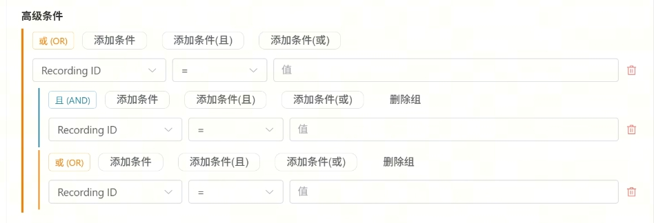

# 数据湖圈选到数据集创建｜总体需求说明

## 一、需求背景

数据湖圈选将成为数据准备的主要入口。目标方案沿用原「数据查询」页面易用的分组筛选和 recording 预览，接入线上数据湖的高级条件及圈选执行能力，最终完成数据集创建与进度追踪。顶部「固定筛选／执行 SQL」分栏暂时隐藏，保留功能实现，页面直接展示各筛选模块。

## 二、需求清单

| 模块 | 交付内容 |
| --- | --- |
| 数据湖圈选 | 输入固定筛选和高级条件，点击「执行圈选」得到结果；输入过程中不自动执行。 |
| 圈选结果 | 展示命中数量及 recording 列表；支持逐条预览；无命中展示空结果。 |
| 创建数据集 | 使用本次圈选的 recording_id 创建数据集，提交后展示「数据集校验中」。 |
| 数据集创建进度 | 查询任务状态、查看创建条件和失败原因，成功后进入数据集。 |

## 三、需求详情

| 模块 | 图示／入口 | 页面与交互说明 |
| --- | --- | --- |
| 圈选条件 | 数据湖圈选页 | 按「任务信息、处理信息、提示词、导出要求、高级条件」展示。任务信息和处理信息的字段、默认值及选项沿用原数据查询方案。固定筛选与高级条件共同生效；重置恢复默认值。Episode 上限限制返回条数，Prompt 语言控制后续导出的语言。 |
| 提示词 | 数据湖圈选页 | Highlevel、Lowlevel 各一个文本框，提示为「输入 prompt」，无候选下拉。每框输入一段关键词，分别模糊匹配对应层级的中文或英文 prompt，英文不区分大小写；两框同时填写取交集，留空不限制。仅点击「执行圈选」后生效。 |
| 高级条件 | 见下方示意图 | 每个组的 AND／OR 只作用于本组的直接条件和子组。点击组首的「且（AND）」或「或（OR）」切换关系：AND 为蓝色竖条，OR 为橙色竖条；子组可独立切换。 「添加条件」在当前组内增加一行；「添加条件(且／或)」增加对应关系的子组；可删除条件和非根组。字段、运算符及值应按字段类型适配；必填条件值缺失时提示并阻止执行。 |
| 执行与结果 | 数据湖圈选页下方 | 点击「执行圈选」后显示执行反馈，再展示命中数量与结果列表。列表至少展示 recording_id、Task ID、设备、类型、是否质检、是否标注、帧数、时长及操作。每行「预览」打开该 recording 的视频、轨迹和标注信息；无结果时展示空态，不允许用空结果创建数据集。 |
| 创建数据集 | 圈选结果 →「用圈选结果创建数据集」 | 弹窗展示本次圈选条数；「标识」必填、英文唯一标识、最多 200 字符；「数据集名称」必填，填写标识后自动带出且可修改；「选择目录」可选；「标签」支持层级选择或创建，并随数据集保存。不展示生成格式、可见范围、纳入质检不合格视频等额外字段。确认创建后提交任务并展示「数据集校验中」面板，提供「查看进度」入口。 |
| 创建进度 | 「查看数据集创建进度」或校验中面板 | 列表支持按数据集名称、创建人查询／重置，按状态筛选及分页；展示 ID、数据集名称、标识、状态、创建时间、创建人、操作。状态包括校验中、进行中、成功、失败。「任务详情」展示创建时的圈选条件快照；仅成功任务可「查看数据集」。失败状态旁可打开「异常原因」，明确展示失败阶段及受影响的 Task ID、Recording ID。 |
| 校验异常 | 创建进度 →「异常原因」 | 至少覆盖视频文件缺失，以及 Feature／数据格式不一致。视频缺失按 Task ID 列出缺失的 Recording ID；Feature 不一致按格式组列出各组的 Task ID 与 Recording ID，便于定位不兼容数据。ID 数量较多时先展示前 10 个，支持展开全部。失败任务不可进入数据集，可返回圈选页调整条件后重新创建。 |

高级条件示意（橙色 OR 组中可嵌套蓝色 AND 组）：

**与线上现状的差异：** 标签和逐条 recording 预览是本方案要保留／补充的能力，线上数据湖创建弹窗当前没有标签。创建看板数据集与全量 LeRobot 文件导出是两条独立操作。

**验收口径：** 条件只在执行时生效；AND／OR 切换后结果符合嵌套逻辑；结果预览与创建使用同一次圈选结果；创建任务在进度页可追踪，失败原因能定位到具体 recording。

参考：[线上数据湖圈选](https://quanta-test.i.spirit-ai.com/data-preparation/datalake-dataset)、[原数据查询](https://quanta-test.i.spirit-ai.com/data-preparation/data-query)、[需求说明样例](https://nwd4iy9rd2s.feishu.cn/wiki/Uvc9weMF9iF7gmk85upcpe91nBg?from=from_copylink)。
